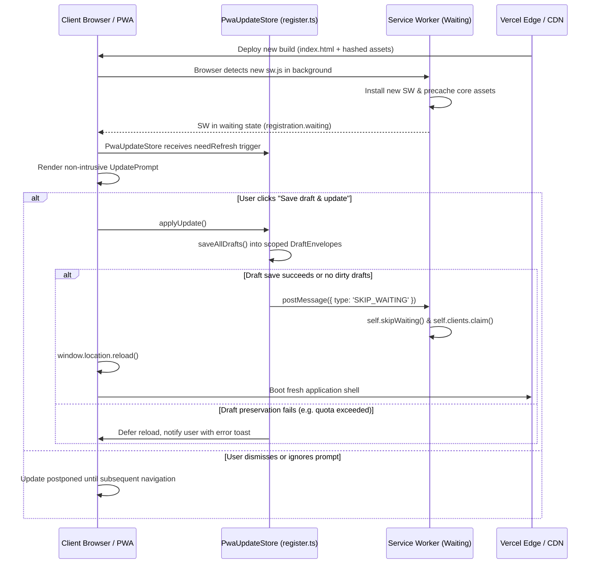

# SideBy PWA & Service Worker Release Runbook

Version: 1.2.0
Target Architecture: Vite + `vite-plugin-pwa` (injectManifest strategy via `src/sw.ts`) + Workbox
Working Tree Status: Active modifications in working directory (uncommitted).

---

## 1. Release Lifecycle & Update Flow



### 1.1 Update Behavior & Preservation Guarantees

1. **Production Service-Worker Registration**:
   - `frontend/src/lib/pwa/register.ts` relies on the static `import { registerSW } from "virtual:pwa-register"` so Vite and Rollup bundle the virtual module provider into production client artifacts without missing module errors.
   - `initServiceWorker()` registers the worker with `immediate: true` in production mode.

2. **Scoped Draft Envelope & Integrity**:
   - Registered forms snapshot data into `sessionStorage` (`sideby_preserved_drafts_v1`) enclosed in a typed `DraftEnvelope<T>`:
     - `version: 1`
     - `createdAt: number`
     - `kind: string`
     - `scope: { userId: string | null, workspaceId: string | null, anonymous: boolean }`
     - `data: T`
   - Scopes are enforced: users cannot restore drafts belonging to another `userId` or `workspaceId`.
   - Legacy, unversioned, or unscoped records are discarded rather than restored.
   - Envelopes older than 24 hours (`DRAFT_RETENTION_MS`) or larger than 16 KiB (`MAX_DRAFT_BYTES`) are rejected.

3. **Honest Failure Handling (No Silent Work Discarding)**:
   - If `saveAllDrafts()` encounters a storage exception (e.g. `QuotaExceededError` or disabled storage) while forms have unsaved dirty content, `applyUpdate()` **aborts the reload**, logs an error, and leaves the user's current session and inputs intact.
   - We do not claim universal draft preservation; browser storage constraints apply.

4. **Session Boundary Purging**:
   - `pwaUpdates.clearAuthenticatedDrafts()` is invoked on user sign-out or account switch to prevent draft leakage across sessions on shared devices.

5. **Concurrency & Intent Locking Guarantee**:
   - `createComparisonJob` in `frontend/api/_lib/sideby.ts` requires a token-scoped lock before any job record is inserted or any AI pipeline is queued.
   - If lock contention occurs, the worker retries up to 4 times (2 seconds). If contention persists and no concurrent job can be adopted, it returns an explicit `409` HTTP response (`COMPARISON_IN_PROGRESS`, `Retry-After: 2`) rather than falling through to an unprotected insert.

6. **Explicit Activation via `SKIP_WAITING`**:
   - `registerType: "prompt"` ensures the waiting worker does NOT take over mid-session without user prompt acknowledgment, preventing chunk mismatch errors.

7. **Outdated Cache Cleanup**:
   - On SW `activate`, old Workbox precaches and legacy `sideby-cache-*` namespaces are purged automatically via `cleanupOutdatedCaches()`.

---

## 2. Cache Invalidation & Routing Rules

| Path Pattern | Handler | Purpose |
|---|---|---|
| `/index.html` + revision | Precached | Hashed shell bootstrapper |
| `/assets/*.{js,css}` | Precached or `StaleWhileRevalidate` | Static immutable application bundles |
| `/api/*` and `/api` | `NetworkOnly` | **STRICTLY ZERO CACHE**. Comparisons, research mutations, auth checks |
| `/auth/callback*` | Denylisted from SPA fallback | OAuth and SSO callbacks must hit network directly |
| Cross-origin static assets | `CacheFirst` (max 60 entries, 30 days) | Public logos and Google Fonts only. Excludes signed URLs (`token=`, `signature=`) |

---

## 3. Precache Budget Guidelines

- **Maximum Precache Size**: Under **3.0 MiB** (current: **2.78 MiB** uncompressed / ~700 KiB gzip).
- **Excluded Modules**:
  - `**/vendor-observability-*.js` (Sentry) — Loaded asynchronously.
  - `**/vendor-charts-*.js` (Recharts / D3) — Loaded on-demand when charts render.
  - `**/snapsolve*.png` and large decorative images.
- **Verification Command**:
  ```bash
  pnpm run build
  ```
  Look for the `precache <N> entries (<size> KiB)` log in the PWA output.

---

## 4. Local Verification & Release Testing Checklist

Execute before every release candidate:

1. **Typecheck & Lint**:
   ```bash
   pnpm run typecheck
   pnpm lint
   ```
2. **Unit & Integration Tests**:
   ```bash
   pnpm test
   ```
   (Must pass all 21 test files, including duplicate intent locks and draft envelope preservation suites).
3. **Production Service Worker & Lifecycle E2E**:
   ```bash
   pnpm exec playwright test e2e/pwa-lifecycle.spec.ts
   ```
   (Must verify registration, activation, controller takeover, offline shell delivery, NetworkOnly API routing, and scoped draft restoration).
4. **Full Multi-Engine Browser Suite**:
   ```bash
   pnpm exec playwright test
   ```
5. **Physical Device Audit Note**:
   - Automated testing covers WebKit and Chromium emulation.
   - Physical iOS Safari Share Sheet ("Add to Home Screen"), hardware Taptic Engine response, and native Face ID modal flows require manual verification on physical iOS hardware prior to major native PWA promotions.

---

## 5. Emergency Service Worker Rollback Procedure

If a deployed service worker causes runtime anomalies or broken routing:

### Step 1: Deploy a Bypass Service Worker
1. Deploy an updated build whose `sw.ts` includes immediate unregistration or `clientsClaim()` with pass-through network handlers.
2. Alternatively, deploy a minimal pass-through worker:
   ```ts
   self.addEventListener("install", () => self.skipWaiting());
   self.addEventListener("activate", (event) => {
     event.waitUntil(
       caches.keys().then((keys) => Promise.all(keys.map((k) => caches.delete(k))))
         .then(() => self.clients.claim())
     );
   });
   ```

### Step 2: Clear Client Caches
- Because `sw.js` is served with `Cache-Control: no-cache, no-store, must-revalidate` from Vercel (`vercel.json`), browsers re-check `sw.js` on every navigation or at least every 24 hours.
- Active clients receiving the update will call `caches.delete()` and reload to pure network mode.

### Step 3: Verify Rollback in Clean Profile
1. Open DevTools -> Application -> Service Workers.
2. Verify that old cache keys are removed and current requests pass directly to the network.
