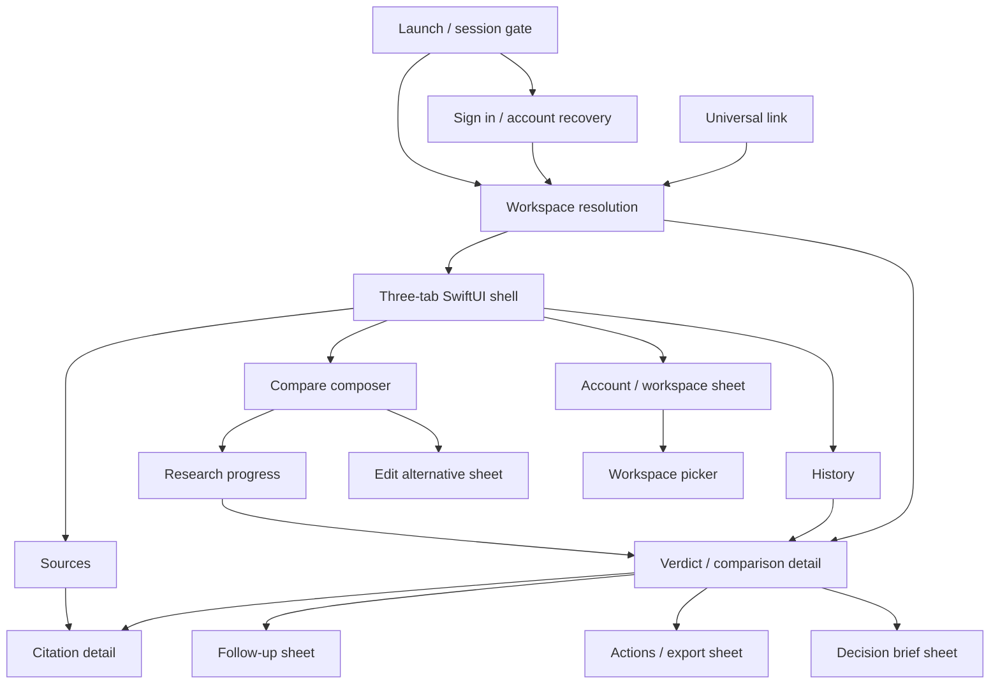

# SideBy iOS — SwiftUI 26 product and motion plan

Planning revision 1 · 2026-10-19 · Decision: target a **Swift 6.4+, SwiftUI-only iOS client, minimum iOS 26**, built with Xcode 26 or newer. This is a proposed execution plan, not a claim that the new app exists. The current production candidate is React Native/Expo. The user’s new native direction supersedes the React Native architecture recommendation in `SIDEBY_IOS_MASTER_PLAN.md`; preserve that document’s audits and backend findings as historical evidence.

## 1. Concept — three commitments

- **A decision instrument, not a chat skin.** Compare two alternatives in a shared SnapSolve workspace, watch a real research job, inspect its reasoning and citations, and carry the same saved record to the web.
- **Motion makes state legible.** Every screen responds to entry, touch, scroll and navigation; a spring or morph always explains a change. Reading, uncertainty, and failure states stay calm. The app must remain fully usable with Reduce Motion.
- **Glass frames the work.** Navigation, floating actions, toolbars, and transient controls use system Liquid Glass where it improves hierarchy. Long text, verdicts, citations, and data use solid or standard-material reading surfaces. Apple’s [Materials guidance](https://developer.apple.com/design/human-interface-guidelines/materials) explicitly reserves Liquid Glass primarily for the controls/navigation layer.

## 2. Current reality and migration boundary

The inspected mobile tree uses React Native/Expo SDK 57, currently has Compare, History and Sources tabs plus authentication, comparison detail, account, decision-brief and edit-option modals. Its live tab layout now imports `expo-router/unstable-native-tabs`, while the 2026-10-13 ledger still describes the older custom bar. The tree also has new session/cache and screen work in progress. Treat it as a behavior/reference baseline, **not a completed SwiftUI implementation or an accepted builder report**.

The SideBy Vercel API remains the single backend for iOS and web. It owns research jobs, workspace authorization, persistence and exports; SnapSolve Core owns the shared workspace/subscription authority. The native app must reuse those contracts and server IDs. It must never fabricate results, infer an entitlement from a missing field, or let a local cache cross an identity/workspace boundary. Do not port React components line by line: recreate the user journeys against verified API fixtures, preserve the web’s records and keep server authorization authoritative.

The forwarded B00-R3/B01-R3/B02-R3 work is still useful as source recovery, API truth and behavioral evidence. Once a safe patch/report is delivered, stop investing in React Native-specific material/tab polish that will be discarded. Do not alter those ticket statuses without their evidence review. Give the builder this strategic delta before assigning new UI implementation.

**Environment observed:** Xcode 27.1 and Apple Swift 6.4 are installed locally. The minimum supported app runtime is iOS 26 by product decision; test on iOS 26 and the current runtime. “Xcode 26+” is the requested lower bound, but each builder/CI toolchain must actually contain Swift 6.4; pinning the observed Xcode 27.1 is the reproducible starting point. No earlier-iOS visual fallback is required, but Reduce Transparency, Increase Contrast, light/dark mode, larger text and Reduce Motion remain required on supported OS versions.

**Present motion audit:** the current RN app has spring tokens, press feedback, haptics, a swipeable History row and an ambient research-orb animation. The inspected Compare/History/Sources screens use ordinary scroll views/lists without scroll-linked transition handlers; the current gradient-and-glow background is visually static. `ResearchOrbPipeline` starts repeated pulse/rotation work, while the newer `ResearchProgress` screen uses a simple activity indicator and stage list. Before porting any animated element, identify which component is actually mounted and whether its progress is server-authored. The SwiftUI plan replaces scattered effects with one state-aware motion policy rather than simply adding more loops.

## 3. Navigation and screen map

Use one typed `AppRoute` and one typed `AppTab` (`compare`, `history`, `sources`). Each tab owns a `NavigationStack(path:)`; a deep-link coordinator resolves links only after auth and workspace readiness. Preserve the selected tab and per-tab path where safe. Account and short tasks use SwiftUI sheets; comparison details and cited sources use pushed destinations. Universal links open an existing comparison by server ID or an approved slug after authorization, never by trusting a link’s workspace claim.

| Screen | Key controls and placement | States that must be designed |
| --- | --- | --- |
| Launch/session | Brand and quiet progress in center; recovery action only when needed | resolving, signed out, signed in, guest example, configuration failure, offline |
| Sign in / sign up | System-sized title; credentials/SSO actions in form; help below | pending, cancellation, auth error, account creation, deep-link return |
| Workspace picker | Current workspace in top leading navigation area; searchable memberships in sheet | none, one, many, revoked, Core unavailable, switch pending |
| Compare | Workspace/title at top; two labeled alternatives and swap between; context below; one Compare action near keyboard/footer; example presets secondary | idle, editing, invalid, pending, rate limited, offline, unknown entitlement |
| Research | Entities and job identity at top; current server stage and last update; exit to History | queued, running, stalled, reconnecting, failed, completed; no invented percentage |
| Verdict | Recommendation/uncertainty first; evidence and criteria below; favorite, follow-up and overflow actions in toolbar | decisive, tie, partial evidence, no winner, stale, export/favorite failure |
| Citation | Claim link, passage/summary, publisher/date, open source/report actions | missing URL, broken link, unsupported claim, stale source |
| History | Search and filters under title; dated rows; visible favorite plus swipe actions | loading, paginating, true empty, filtered empty, offline cached, error |
| Sources | Honest scope label above search/list; source rows and associated comparisons | true empty, partial aggregation, all failed, limited recent slice, offline |
| Account | Profile/workspace and shared subscription/usage; appearance, accessibility, cache, privacy and sign-out | known/unknown/inactive entitlement, loading, error, clear-cache confirmation |
| Follow-up and action sheets | Focused question/action, explicit confirm/cancel, detents fitting keyboard | composing, sending, failed, malformed acknowledgement, dismissal |
| Decision brief sheet | Exportable summary only when generated by the server; share/export controls at bottom | unavailable, generating, ready, export failure; no static fabricated brief |
| Edit alternative sheet | One focused field with save/cancel and validation | unchanged, invalid, unsaved, submitting, failed |

The custom SwiftUI tab bar is a **bounded exception to the system-default preference** because the user explicitly requested it. Build it with `GlassEffectContainer`, three labeled SF Symbol buttons, selected state, 44×44pt hit regions, VoiceOver tab semantics, safe-area placement, keyboard-aware behavior, and reselect-to-top. Prototype it beside a native `TabView` baseline. Keep the custom bar only if it matches or exceeds navigation, deep-link, Dynamic Type and accessibility behavior; the system bar remains the fallback decision if the custom version fails. Avoid a second navigation dock for the ecosystem.

## 4. Design system and material policy

**Structure.** `App/`, `Core/Networking/`, `Core/Identity/`, `Core/Workspace/`, `Core/Cache/`, `Core/DesignSystem/`, and feature folders `Features/Compare/`, `Research/`, `Verdict/`, `Evidence/`, `History/`, `Sources/`, `Account/`, `Authentication/`. One Swift type per file, with views split into focused subviews. `@Observable` models and Swift concurrency actors own data; view bodies do not perform parsing, filtering of large collections, or network work. Use Foundation/SwiftUI/OS frameworks only for UI; any identity SDK is a separate security/contract decision, not a UI framework. No UIKit bridge in the UI plan.

**Type.** Use semantic SwiftUI text styles (`largeTitle`, `title`, `headline`, `body`, `subheadline`) with Dynamic Type. A/B labels remain words and symbols as well as color. Body/evidence text is comfortable for sustained reading, multiline, selectable where useful, and never placed in a fixed-height card. Use `ViewThatFits` or vertical reflow at accessibility sizes. SF Symbols convey familiar actions; animated symbol effects are brief and event-bound.

**Color.** Define named asset-catalog roles for light/dark: canvas, reading surface, elevated surface, primary/secondary text, separator, action, A/copper, B/cyan, success, caution and error. Current RN light/dark values are starting references, not final measured tokens. Use native semantic colors for ordinary chrome; test A/B and status tokens on real rendered surfaces. Never encode winner, failure or source trust by color alone.

**Background.** Replace the current dark vignette/orb texture with a quiet adaptive canvas: system-compatible light/dark base, restrained A/B chromatic accent only near the composer or hero, and still reading surfaces beneath long content. Motion in the background is optional, very low amplitude, and stops while scrolling/reading, when the app is inactive, in Low Power Mode, or with Reduce Motion. No continuous full-screen particle field or constant glow drift.

**Glass roles.** Use system navigation/toolbar/sheet rendering first. For custom tab bar and one or two floating actions, use native `.glassEffect(.regular, in:)`, `.buttonStyle(.glass)`/`.glassProminent`, and group related controls in `GlassEffectContainer`. Apply glass after layout/appearance modifiers; use `.interactive()` only for controls. Use `glassEffectID` for morphing controls and `matchedGeometryEffect` for content heroes, with stable IDs and a common namespace. Do **not** coat evidence cards or paragraphs in glass. An occasional compact interactive card may have a glass control on an otherwise opaque content card. Avoid clear glass over uncontrolled text/backdrops; sample rendered contrast. Apple’s [custom glass guidance](https://developer.apple.com/documentation/SwiftUI/Applying-Liquid-Glass-to-custom-views) documents grouping and morphing.

**Accessibility fallback.** When Reduce Transparency is enabled, present opaque/high-legibility control surfaces rather than relying on blur. Increase Contrast strengthens text, icon, focus and selected-state differentiation. Reduce Motion removes parallax, shimmer, broad translation and repeated pulses; it retains instant state change or a short opacity crossfade. VoiceOver announces state changes without reading decorative motion. Check light/dark × default/Increase Contrast × Reduce Transparency on actual rendered backgrounds; no blanket AAA claim before measurement.

**Motion language.** Define four reusable recipes, tuned on device rather than treated as guaranteed constants: micro feedback (roughly 120–220 ms), navigational spring (roughly 250–450 ms), disclosure/hero (roughly 350–550 ms), and ambient status (slow, bounded, never indefinite when hidden). Use `withAnimation(.spring(...))` for discrete state changes; `scrollTransition`/`visualEffect` for scroll-linked transforms, and `matchedGeometryEffect` for source-to-destination continuity. Scroll animation must be driven by visible content and scroll phase, without writing every pixel offset into global app state. Gesture motion tracks the finger; release uses velocity-aware spring and supports interruption. Use SwiftUI `sensoryFeedback` for semantic thresholds/confirmation, not every frame. Apple’s [Motion guidance](https://developer.apple.com/design/human-interface-guidelines/motion) calls for purposeful, cancellable motion and reduced-motion alternatives.

## 5. Per-screen animation contract

Each row specifies **entrance · gesture · scroll · transition**, including a reduced-motion interpretation. “No scroll” means a stable surface, not a missing specification.

| Screen | Entrance | Gesture and haptic | Scroll response | Exit / transition and reduced-motion behavior |
| --- | --- | --- | --- | --- |
| Launch/session | Brand opacity and small scale settle once; progress appears only while resolving | Retry compresses subtly; one confirmation haptic on recovery | No scroll; stable frame | Crossfade to auth/workspace; Reduce Motion uses immediate opacity only |
| Sign in / sign up | Title/form reveal in short sequence after auth readiness | Focus ring and button press spring; success/error haptic after result | Form scroll follows focused field and keyboard without parallax | Sheet-to-shell dissolve, restoring deep link; Reduce Motion removes translation |
| Workspace picker | Sheet rises with system spring; selected workspace marker appears | Row press/selection haptic; drag detents follow finger | List rows use very small `scrollTransition` fade near edge | Selection closes sheet then refreshes scoped content; no stale cross-workspace hero; Reduce Motion uses static list |
| Compare | Header, two fields and CTA reveal in a brief hierarchy; no perpetual decorative loop | Swap rotates only the two labels/values with a spring and haptic; preset fills fields with matched emphasis; CTA responds to press | Header accent compresses/softens; example rows fade at edges; no moving text while typing | CTA compresses into real research status only after server ID; invalid response returns to stable form; Reduce Motion uses opacity/state text |
| Research | Server stage and entities arrive with a contained reveal; skeleton mirrors real layout | Stage disclosure opens on tap; haptic only when a new server stage arrives | Timeline becomes compact under nav; progress does not animate toward an invented value | On complete, stage marker becomes verdict hero; on failure, status crossfades to retry; Reduce Motion removes pulse/shimmer |
| Verdict | Hero from research/history identity using matched geometry when both source and target exist; summary appears after hero settles | Evidence expands under finger with spring; favorite state waits for server acknowledgement/rollback; haptics only on confirmed action | Hero collapses into title; sections reveal once at threshold, then stay still; citation rows never continuously shimmer | Push citation with source-title continuity; follow-up/action sheet grows from triggering control; Reduce Motion uses normal push/fade |
| Citation | Claim and source metadata reveal together; no authority badge without validation | Open-source button compresses, report menu uses system feedback | Passage/highlight stays stable; top metadata compacts gently | Return preserves reading position; external browser transition uses system; Reduce Motion removes highlight sweep |
| History | Visible rows enter with a modest stagger capped to the first viewport; cached rows appear immediately | Swipe actions track finger; favorite star animates to pending/confirmed/reverted and announces result | Search/header compress; rows get edge fade only, no whole-list parallax | Tapped row morphs into verdict hero when geometry exists; deep-linked detail uses normal push; Reduce Motion disables stagger/morph |
| Sources | Scope and list appear together; partial-failure banner appears without obscuring rows | Filter chip spring/haptic; pull-to-refresh tracks finger, then system progress | Search header condenses; only small icon/accent transitions at edge | Source row pushes citation detail; error/empty state crossfades in place; Reduce Motion keeps stable rows |
| Account | System sheet entrance; usage metrics count only from authoritative finite values | Workspace row, cache confirmation and sign-out give one tactile response each | Sections remain mostly static; navigation header compacts naturally | Dismiss with system sheet; sign-out clears content before auth transition; Reduce Motion leaves standard sheet or fade |
| Follow-up/actions sheets | Native detent presentation from toolbar/control; form content reveals after sheet settles | Sheet drag is direct; send button haptic on accepted request, error on failure | Scroll avoids keyboard and preserves question cursor; no shimmer over prose | Confirmed answer pushes/expands in verdict; dismissal restores focus; Reduce Motion uses system minimal transition |
| Decision brief sheet | Server-backed summary reveals by section after data is ready; skeleton uses final geometry | Share/export button gives confirmed feedback; detent drag follows touch | Long summary scroll is stable; only section headers settle lightly at first appearance | System sheet close returns to verdict; Reduce Motion shows content without stagger |
| Edit alternative sheet | Existing value is present immediately; save affordance appears with keyboard | Field focus and save press spring; unsaved-dismiss confirmation uses system dialog | Focused field clears keyboard and detent without parallax | Successful save updates composer or verified server record, then sheet dismisses; Reduce Motion uses state swap |

Loading skeletons appear only when no useful cached content exists; use low-luminance shimmer for a short bounded period and pause offscreen/background. For longer requests show an explicit current stage or “still working” state. Scroll effects are clamped to small offsets, respect `accessibilityReduceMotion`, and never cause text to lose contrast or jump while VoiceOver focuses it.

## 6. Shared backend, identity and offline contract

The native API client uses `URLSession`, async/await, typed `Codable` DTOs and a single trusted HTTPS origin. Attach a short-lived user token only to approved API paths; redact credentials from logs. Preserve HTTP error codes, `Retry-After`, cancellation and explicit timeout behavior. Keep transport DTOs separate from feature display models. Use fixtures copied from authorized staging or current handler contracts, then validate actual staging responses before acceptance.

Map `POST /api/ecosystem/session`, `/api/workspaces` and `/api/projects` to a resolved identity/workspace context; preserve both SideBy local and canonical SnapSolve workspace IDs. The backend checks membership and entitlement on every protected request. Use the existing comparison create/list/detail/manage/actions/feedback and `GET /api/usage` contracts. Server job status is the only source for progress; use bounded polling or verified push support, cancel on navigation and resume by job ID. A successful favorite/export/follow-up requires the expected server acknowledgement. Sources currently aggregate from a limited comparison slice: label that scope until an authorized paginated endpoint exists.

Cache only the minimal completed records needed for offline reading, keyed by user **and workspace**, encrypted or protected as appropriate after threat review. Clear or revoke on sign-out/switch/permission change, cancel in-flight tasks, and reject late responses from the previous scope. Offline never initiates a research job or implies current entitlement; stale cached content is dated. Example comparisons have separate IDs and permanent example labels. Keep the shared subscription in Core; no independent iOS purchase state. Any iOS purchase flow requires a later storefront/compliance review.

## 7. Ordered executor tasks and acceptance gates

Each task is a separate reviewable patch. Executors report files, commands/exit codes, screenshots or traces, current simulator/runtime, unresolved gates and exact next action. No executor self-accepts a ticket. Run the first four tasks before visual polish; do not parallelize work that depends on unverified identity or API contracts.

| Order | Ticket / owner | Deliverable and exact work | Gate to pass |
| --- | --- | --- | --- |
| 0 | S00 coordinator / baseline | Review incoming B00-R3/B01-R3/B02-R3 evidence; capture RN route/state/API parity and safe source snapshot; freeze target iOS 26+/SwiftUI decision. Stop RN-only polish after handoff. | Document what RN behavior is verified vs merely implemented; no secret/source loss. |
| 1 | S01 native foundation | Create a new isolated native Xcode target/project under an agreed path, Swift 6.4 language mode, iOS 26 deployment, SwiftUI App lifecycle, feature folders, one type/file, asset catalog and build schemes. Do not overwrite RN source. | Clean simulator build and first launch on iOS 26 plus current runtime; CI reproducibility and no third-party UI framework. |
| 2 | S02 contract/client | Implement trusted-origin `URLSession` client, typed errors/DTOs and redacted fixture tests for session, workspaces, comparison create/list/detail/manage/actions and usage. Write a route/fixture matrix from actual handlers. | Malformed, 401/403/404/429/5xx, cancellation, timeout, token-gating and unknown-field tests; authorized staging handshake. |
| 3 | S03 auth/workspace/cache | Integrate an approved native auth approach, typed deep-link coordinator, workspace/entitlement context, per-user/workspace cache and purge lifecycle. | A→sign-out→B, workspace X→Y, revoked access and late-response tests; real record opens on web and iOS without leakage. |
| 4 | S04 design/motion primitives | Build semantic light/dark assets, typography, `MotionPolicy`, `GlassPolicy`, custom tab prototype beside native baseline, haptic map, loading/empty/error views. | Rendered contrast/accessibility matrix; Reduce Motion/Transparency, largest text, VoiceOver and tab/deep-link comparison pass. |
| 5 | S05 Compare + Research | Implement composer, truthful validation, server create, job progress/resume and first hero transition. | Real staging job ID/status; offline/denied/failed/stalled states; no synthetic percent; motion video and reduced-motion equivalent. |
| 6 | S06 Verdict + Citation | Build evidence-first result, tied/partial states, citation detail, favorite/feedback, follow-up and export sheets. | Server-acknowledged mutations and both export formats; claim/source trace; rollback and gesture/VoiceOver tests. |
| 7 | S07 History + Sources + Account | Search/filter, pagination/scope disclosure, swipe/pull, shared usage/subscription and cache controls. | Empty/partial/all-failed/offline states; inactive/unknown entitlement truth; cross-workspace isolation. |
| 8 | S08 motion/accessibility polish | Tune per-screen motion contract, matched heroes, scroll transitions, haptic thresholds and reading stability. | Video matrix every screen; Reduce Motion, Dynamic Type, VoiceOver, Increase Contrast, Reduce Transparency; no blocked interaction or incessant loop. |
| 9 | S09 performance/integration | Profile Release on supported devices for launch, scroll, animation frame pacing, energy, memory and network; fix measured regressions. Run full web↔iOS workspace and subscription journeys. | Recorded device/build/sample conditions, before/after measurements and agreed budgets; no credential leaks. |
| 10 | S10 release candidate | Validate links, privacy, failure recovery, App Store assets and storefront policy; controlled rollout decision. | Product-owner review of captured journeys, contract evidence and release checklist. |

For S04–S08, every screen PR includes a motion sheet with four columns (entrance, gesture, scroll, transition), a normal-motion clip, a Reduce Motion clip, VoiceOver focus order, largest-text screenshot, and a test showing the animation never creates or alters backend truth. Unit tests cover state/contract logic; UI tests cover navigation, accessibility and critical gestures. Animations are measured in Release on device before optimization claims.

## 8. Open decisions and immediate next handoff

1. **Auth integration:** determine whether an approved native identity SDK or a standards-based web authentication handoff can reproduce the existing Clerk session and token contract; do not invent a parallel account system.
2. **Project location and bundle migration:** choose a separate SwiftUI checkout/target so the current RN source and staged B00 evidence remain recoverable. Preserve bundle ID and deep-link ownership only after a tested migration plan.
3. **Custom tab bar:** retain only if S04 verifies system-level behavior and accessible navigation; custom glass is a deliberate product choice, not a claim of automatic system parity.
4. **Sources scope:** decide whether the backend will offer an authorized paginated source index; until then disclose the recent-history slice.
5. **Minimum OS:** iOS 26 excludes older devices; confirm business/support impact before a release commitment. It does not remove accessibility or low-power obligations.

The next builder instruction is **S00 review and S01 native foundation only after the current R3 report is received**. In the meantime, design/contract inventory can proceed read-only. Do not start feature screens or RN-to-SwiftUI component translation before the verified API, auth and workspace boundaries are written down.
