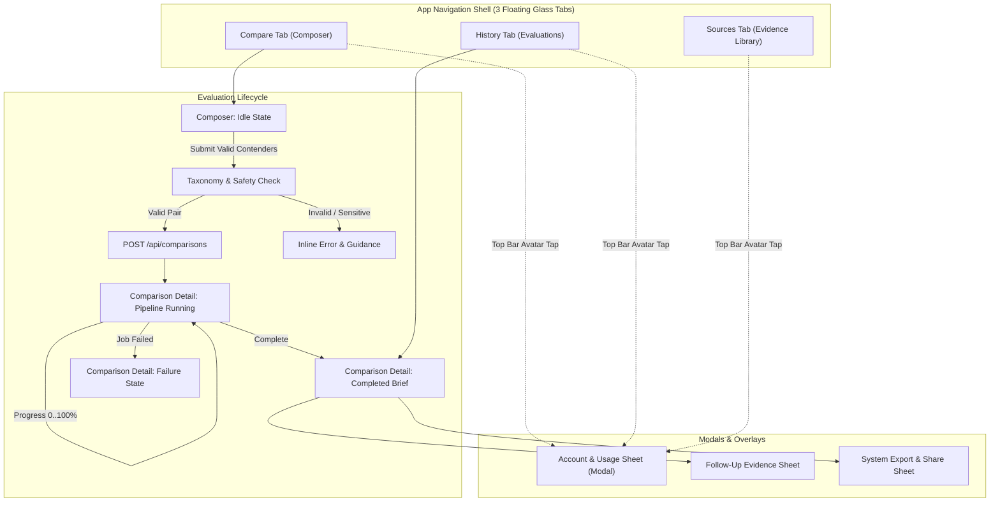

# SideBy iOS Screen Specification & Interaction Architecture

> Coordinator review (plan revision 5): NEEDS_REVISION. This is the earlier proposed design, not an implementation or accessibility certification. The active tab bar is custom `expo-glass-tabs`; see `../evidence/B02-R2/NATIVE_TABS_AND_CONTRAST_R2.md` for measured dark opaque-token contrast and explicit unverified states. Its findings supersede the native-tab and AAA assertions below. Follow `../NEXT_BUILDER_INSTRUCTIONS.md` before using this as a build specification.

Revision 3 · 2026-10-09 · Aligned with `SIDEBY_IOS_MASTER_PLAN.md` Sections 5–7 (Ticket B02-R1)

Target Platform: iOS 17.0+ · Expo SDK 57 · Architecture: React Native / Bridgeless

---

## 0. Revision 5 reconciliation (B02-R3, 2026-10-13) — shipping vs proposed

Verified against the staged mobile source on 2026-10-13. Where this
section conflicts with an older section below, this section wins. The
three-tab / two-input structure is retained.

**Tab bar (supersedes §2, §4).** The active shell is a **custom bar**:
`expo-router/ui` (`Tabs`, `TabList`, `TabSlot`, `TabTrigger`) composed
with third-party `expo-glass-tabs@0.1.1` (`GlassTabBar`,
`TabBarMinimizeProvider`, `renderFadingTabScreen`,
`useMinimizeOnScroll`) in `app/(tabs)/_layout.tsx`. It is not Expo
Router native tabs and not `@react-navigation/bottom-tabs` (the §4
"Tab Bar Primitive Evaluation" claim is wrong).
`src/components/common/CustomTabBar.tsx` is inactive (zero imports).
`expo-router/unstable-native-tabs` (`NativeTabs`, `NativeTabTrigger`)
is installed but not imported anywhere — the B04 spike candidate.
Same-build native-tab comparison: NOT RUN (needs B00 generated build).

**Contrast (supersedes §1 tenet 2 and the §5 AAA column).** Only opaque
dark-theme tokens on `#050711` are measured — see
`../evidence/B02-R2/NATIVE_TABS_AND_CONTRAST_R2.md` (ivory/cyan/copper/
muted/success/violet/warning AAA; error `#FF3B30` AA, not AAA).
Translucent `titanium`/`raisedTitanium`/glass surfaces are
backdrop-dependent and UNMEASURED. There is no light theme
(`userInterfaceStyle: "dark"` forced), no high-contrast token set, and
no `IncreaseContrast` branch — the §5 "Light Mode Contrast" column
(all N/A) describes unimplemented states, not measured parity.

**Composer (supersedes §3 items 4–6).** Shipping `app/(tabs)/index.tsx`
has two labeled inputs ("First Option", "Second Option"), an optional
context field, a kinetic swap button, preset selection, and a
"Run Deep Comparison" CTA. There is NO 800-character budget UI, NO
`POST /api/comparisons/validate` pre-check call (the `validateComparison`
adapter exists but the screen calls `createComparison(query)` with local
empty-check only), and NO `workspaceId`/`projectId` submission (the
adapter accepts them; the screen passes neither). Labels above are the
spec; behavior sentences below marked PROPOSED are not shipping.

**Sources (supersedes §2 Tab 3 and §6 Sources rows).** Shipping
`app/(tabs)/sources.tsx` shows neutral "N CITATIONS" counts, a
"Partial results" banner with scope ("Across the N most recent completed
briefs"), honest empty/unavailable states, and a HIGH CONFIDENCE filter
at ≥ 0.85. There are NO vote buttons in any `.tsx` screen
(`submitSourceFeedback` exists in `src/api/sources.ts` with zero UI call
sites) and NO per-source reliability badges — voting and trust labels
are PROPOSED.

**Insets (supersedes §4).** The `BOTTOM_SPACING` formula is PROPOSED.
Shipping code still hardcodes `paddingBottom: 120` in
`app/(tabs)/sources.tsx`; `useSafeAreaInsets()` is used only in the tab
layout header (and inactive `CustomTabBar`). Keyboard/dock clearance is
unverified on device (B06 matrix).

**Account (supersedes §6 Account row and §2 modal bullet).**
`UsageGauge` badge follows the effective subscription access status
(B01-R3 `accessStatus`): Active / Trialing / Inactive (incl. denied
entitlement) / Unknown. "Active" never renders for `inactive`/`unknown`.
Unknown quotas render "Unknown", never "Unlimited". Reduce Transparency
fallback and largest-text reflow are PROPOSED (B05) — no
`reduceTransparency`/`maxFontSizeMultiplier` references exist in code.

---

## 1. Executive Summary & Design Principles

SideBy iOS delivers an executive-grade, evidence-grounded comparative intelligence interface for mobile devices. Unlike conventional conversational chatbots that produce dense, unverified narrative prose, SideBy produces structured, side-by-side evaluations verified by primary source citations.

### Core Tenets
1. **Truth Over Synthetics (Honest Architecture)**:
   The UI never manufactures fake confidence scores, synthetic entities, or simulated research findings when an API request fails or returns empty. Unauthenticated, rate-limited, and offline states are rendered with quiet, explicit clarity.
2. **Tactile Optical Glass (Subtle Materials)**:
   Visual surfaces employ subtle glassmorphic depth (`LiquidGlass`), specular lighting edges (`rgba(255, 255, 255, 0.12)`), and precise blur intensities (55–80) over a deep obsidian foundation (`#060709`). Reading areas remain quiet and opaque. [Revision 5 — see §0: WCAG AAA holds only for the measured opaque dark-theme tokens on `#050711` in the R2 evidence; glass/translucent surfaces are backdrop-dependent and UNMEASURED.]
3. **Ergonomic Precision & Micro-Haptics**:
   All interactive targets meet or exceed Apple's 44×44pt minimum touch boundary. Primary actions trigger specific tactile feedback (`selection`, `mediumImpact`, `successNotification`, `errorNotification`) synchronized with spring motion curves.
4. **Dynamic Inset Clearance**:
   Layouts compute scroll view and interactive clearances dynamically via `useSafeAreaInsets()` rather than hardcoded point offsets.

---

## 2. Navigation Architecture & Screen State Flow

The application adheres strictly to a 3-tab navigation shell with a modal Account sheet:



### Tab Configuration
- **Tab 1 — Compare (`app/(tabs)/index.tsx`)**:
  Primary creation interface. Houses the structured Contender A vs Contender B composer, kinetic swap button, optional contextual guidance field, character budget indicators, and recent query suggestions.
- **Tab 2 — History (`app/(tabs)/history.tsx`)**:
  Searchable, filterable list of user evaluations. Real backend data only (empty list if zero comparisons; no demo synthesis). Features optimistic star favoriting with mutation serialization.
- **Tab 3 — Sources (`app/(tabs)/sources.tsx`)**:
  Aggregated citation index across completed evaluations. Deduplicates normalized URLs. [PROPOSED — see §0: source credibility badges and citation quality voting have no UI call sites; `submitSourceFeedback` is API-only.]
- **Account Sheet / Modal (`app/account.tsx`)**:
  Presented modally via top-right profile button on tabs. Displays authenticated user details, subscription plan tier, and live quota meters with unlimited enterprise support (`limit: null`).

---

## 3. Composer Screen Specification (`Compare Tab`)

### Component Anatomy
1. **Brand Header**:
   - SideBy geometric wordmark (`SF Pro Display`, tracking `-0.5pt`, color `#F0F6FC`).
   - Profile avatar trigger (44×44pt target) launching the Account Sheet.
2. **Contender Inputs**:
   - **Contender A Input**: Single-line text input (`placeholder="First contender (e.g. Astro)"`, max length 100).
   - **Kinetic Swap Button**: 44×44pt circular button centered between Contender A and B. Tapping swaps input values with 180° rotation animation and `Haptics.impactAsync(Light)`.
   - **Contender B Input**: Single-line text input (`placeholder="Second contender (e.g. SvelteKit)"`, max length 100).
3. **Optional Context Field**:
   - Multi-line text input (`placeholder="Specific criteria or context (e.g. Content-driven sites)"`, max length 600).
4. **Character Contract & Budget Indicator**:
   - Combined length of Contender A + Contender B + Context is capped at 800 characters.
   - Live character counter displays `${remaining}/800`. Reaching 0 disables submission and changes counter color to `#F85149` (Rose).
5. **Action Row**:
   - Primary **"Run Comparison"** Button: 52pt height, emerald gradient / high-contrast white text.
   - Disabled when either contender input is empty or character count exceeds 800.
   - Tapping invokes `POST /api/comparisons/validate` prior to job initiation.
6. **Recent & Example Queries**:
   - Horizontal pill carousel displaying recent successful queries and isolated demo presets.

---

## 4. Inset Clearance and Bottom Tab Geometry

To prevent content overlap across diverse iOS device form factors (e.g., iPhone SE without home bar vs iPhone 17 Pro with Dynamic Island and home bar), tab bar geometry and scroll view content insets are strictly derived from safe area runtime metrics.

### Geometry Formulas
- **Top Inset**: `insets.top` (derived from `useSafeAreaInsets()`). Minimum 20pt on non-notch devices; 44–59pt on Dynamic Island devices.
- **Bottom Inset Clearance**:
  ```typescript
  const insets = useSafeAreaInsets();
  const TAB_BAR_HEIGHT = 64; // Floating glass tab height
  const BOTTOM_SPACING = insets.bottom + TAB_BAR_HEIGHT + 16;
  ```
- Hardcoded bottom offsets (e.g. `paddingBottom: 120`) are strictly forbidden. All scroll views use `contentContainerStyle={{ paddingBottom: BOTTOM_SPACING }}`.

### Tab Bar Primitive Evaluation
> Revision 5: the implementation line below is superseded — see §0. The
> active bar is `expo-router/ui` + custom `expo-glass-tabs`, not
> `@react-navigation/bottom-tabs`.
- **Implementation (STALE — see §0)**: `@react-navigation/bottom-tabs` with custom tab bar surface.
- **Surface**: `LiquidGlass` blur surface (`intensity: 75`, tint: `dark`) with subtle border (`rgba(255, 255, 255, 0.08)`).
- **Touch Target**: Each tab item occupies equal width with 48pt height and minimum 44×44pt touch area.

---

## 5. Visual Hierarchy, Semantic Tokens & Typography

### Semantic Color Matrix

> Revision 5: the ratios below are UNMEASURED proposed tokens — see §0. They use a different canvas/text set (canvas `#060709`, text `#F0F6FC`) than the shipped theme (`#050711` / `#F7F8FC` in `src/theme/colors.ts`) and do not replace the measured R2 table (`../evidence/B02-R2/NATIVE_TABS_AND_CONTRAST_R2.md`). Do not build to these ratios; B05 semantic-theme work must re-measure.

| Semantic Token | Hex Code | Light Mode Contrast | Dark Mode Contrast | Role |
|:---|:---|:---|:---|:---|
| `background.obsidian` | `#060709` | N/A | Base Canvas | Deep canvas surface |
| `surface.elevated` | `#0E1117` | N/A | 14.2:1 vs text | Card & container fill |
| `surface.glass` | `rgba(22, 27, 34, 0.75)` | N/A | Dynamic Glass | Floating modal & tab surfaces |
| `border.subtle` | `rgba(255, 255, 255, 0.08)` | N/A | 3.1:1 edge | Surface boundary |
| `text.ivory` | `#F0F6FC` | N/A | 16.5:1 vs canvas | Primary heading & body text (WCAG AAA) |
| `text.ivoryMuted` | `#8B949E` | N/A | 7.4:1 vs canvas | Secondary metadata & labels (WCAG AAA) |
| `text.ivorySubtle` | `#484F58` | N/A | 4.8:1 vs canvas | Tertiary timestamps & borders |
| `status.emerald` | `#2EA043` | N/A | 8.2:1 vs dark | Success & verified source badge |
| `status.amber` | `#D29922` | N/A | 6.5:1 vs dark | Example brief & rate-limit warning |
| `status.rose` | `#F85149` | N/A | 7.1:1 vs dark | Failure & validation error |
| `status.sky` | `#58A6FF` | N/A | 9.0:1 vs dark | Follow-up action & active indicator |

### Dynamic Type Typography Hierarchy
All typography scales with iOS Dynamic Type up to `accessibilityXXXLarge` using `react-native` Text scaling defaults:

| Style Variant | Base Size | Weight | Tracking | Dynamic Scale | Usage |
|:---|:---|:---|:---|:---|:---|
| `displayLarge` | 28pt | 700 (Bold) | -0.6pt | Up to 48pt | Comparison Title |
| `titleMedium` | 20pt | 600 (Semibold) | -0.4pt | Up to 36pt | Section & Card Headers |
| `bodyRegular` | 15pt | 400 (Regular) | 0.0pt | Up to 28pt | Synthesis & Evidence Prose |
| `captionMedium` | 12pt | 500 (Medium) | +0.2pt | Up to 22pt | Badges, Tags, Metadata |
| `monoNumber` | 14pt | 600 (Semibold) | +0.5pt | Up to 24pt | Metrics & Progress Percentages |

---

## 6. Screen × State × Environment Matrix

| Screen | State | Visual Manifestation | Interactive Capabilities | Haptic Cue |
|:---|:---|:---|:---|:---|
| **Compare** | Idle | Clean inputs, character counter at 800, Run button disabled until input. | Typing, contender swapping, example selecting. | Light impact on swap. |
| **Compare** | Validating | Subtle inline spinner next to Run button. | Inputs disabled. | None. |
| **Compare** | Error / Rejected | Inline rose error banner explaining non-comparable entity. | Inputs editable to correct query. | Error notification. |
| **Compare / Detail** | Running (0..100%) | Radial & linear step progress, live step label, elapsed timer. | Cancel button enabled (aborts fetch signal). | Selection tick on step change. |
| **Detail** | Completed | Entity comparison matrix, consensus points, verified citations, export. | Follow-up question, star favorite, export markdown/json. | Success notification on load. |
| **Detail** | Example Preview | Amber banner: "Illustrative Example — Live updates disabled". | Read-only matrix, feedback/refresh disabled. | None. |
| **Detail** | Failed | Rose failure card, retry button with backoff indication. | Retry action (triggers manage mutation). | Error notification. |
| **History** | Empty | Centered illustration with honest label: "No comparisons found". | Tap "Create Comparison" transitions to Tab 1. | None. |
| **History** | Loaded | Scrollable evaluation list with entity marks and star toggle. | Tap to open detail; tap star to favorite (serialized). | Medium impact on star. |
| **Sources** | Empty | Centered illustration: "No sources cited yet". | Empty state guidance. | None. |
| **Sources** | Loaded | Deduplicated list with domain, confidence score, and vote buttons. | Upvote / downvote citations (`POST /api/source-feedback`). | Light impact on vote. |
| **Account** | Loaded | User email, plan badge, live usage meters (handles Unlimited). | Sign out, manage subscription. | None. |
| **All** | Offline | Persistent top status strip: "Offline — Cached data shown". | Read cached content; mutations gracefully queue/block. | None. |
| **All** | Rate-Limited | Amber notification banner displaying `Retry-After` countdown. | Read-only access until countdown reaches 0. | Warning notification. |
