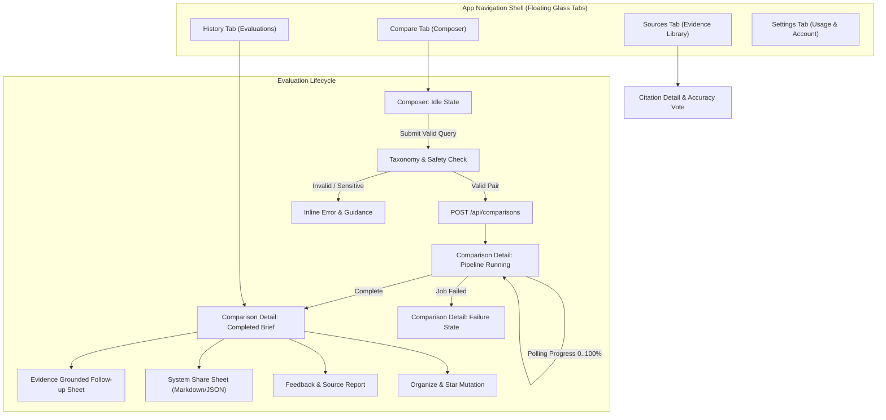

# SideBy iOS Screen Specification & Interaction Architecture

Revision 1 · 2026-10-09 · Companion to `SIDEBY_IOS_MASTER_PLAN.md` (Ticket B02)
Target Platform: iOS 17.0+ · Expo SDK 57 · Architecture: React Native / Bridgeless

---

## 1. Executive Summary & Design Principles

SideBy iOS provides an executive, evidence-grounded comparative intelligence interface on mobile. Unlike conversational chatbots that produce dense unstructured prose, SideBy delivers structured, side-by-side evaluations verified by primary source citations.

### Core Tenets
1. **Truth Over Synthetics (Honest Architecture)**:
   The UI never manufactures fake confidence scores, synthetic entities, or simulated research findings when an API request fails or returns empty. Unauthenticated, rate-limited, and offline states are rendered with quiet, explicit clarity.
2. **Tactile Optical Glass (Subtle Materials)**:
   Visual surfaces employ subtle glassmorphic depth (`LiquidGlass`), specular lighting edges (`rgba(255, 255, 255, 0.12)`), and precise blur intensities (55–80) over a deep obsidian foundation (`#060709`). Reading areas remain quiet and opaque to maintain WCAG AAA text legibility.
3. **Ergonomic Precision & Micro-Haptics**:
   All interactive targets meet or exceed Apple's 44×44pt minimum touch boundary. Primary actions trigger specific tactile feedback (`selection`, `mediumImpact`, `successNotification`, `errorNotification`) synchronized with spring motion curves.

---

## 2. Navigation Architecture & Screen State Flow

---

## 3. Screen Specifications

### Screen 1: Compare & Compose (`app/(tabs)/index.tsx`)
- **Purpose**: Query ingestion, real-time intent disambiguation, and comparison launching.
- **Header**: Quiet brand wordmark `SIDEBY` with obsidian glass blur, active workspace badge, and status pill.
- **Composer Field**:
  - Arc-glass container with `#FF9B73` (Entity A Copper) and `#64D2FF` (Entity B Cyan) dual-focus indicator.
  - Multi-line fluid input with character counter (max 300 chars) and instant clear affordance.
  - Category suggestions chip carousel (e.g., *Software & Infra*, *Hardware*, *Financial Products*, *SaaS Models*).
- **Primary CTA**: Tactile Glass Button (*Run Comparative Brief*).
  - Disabled state: 40% opacity, non-interactive.
  - Active state: Copper accent glow, spring scale compression (`0.96`), haptic medium impact.
- **Baseline Screenshot Reference**:
  See native baseline captured on iPhone 17 Pro: `b00-simulator-baseline.png`.

### Screen 2: Comparison Detail (`app/comparison/[id].tsx`)
- **Header Actions**:
  - Back button (chevron with fluid interactive pop gesture).
  - Status pill (`SOURCE VERIFIED` or `EVIDENCE SYNTHESIS`).
  - Star / Favorite toggle button (with instant optimistic UI and server rollback).
  - Export / Share button (invokes iOS `UIActivityViewController` with formatted Markdown).
  - Refresh button (re-executes fresh research crawl against live web).
- **State A: Research Pipeline (Active/Running)**:
  - Kinetic orb progression with step labels: *Formulating criteria*, *Searching primary sources*, *Extracting entity dimensions*, *Synthesizing consensus & contradictions*, *Finalizing brief*.
  - Step counter and percentage progress bar.
- **State B: Completed Brief**:
  1. **Verdict & Winner Card**: High-contrast card with entity A/B colored badges, summary prose, and key advantages.
  2. **Contender Scrubber**: Horizontal touch scrubber allowing side-by-side criterion switching between contenders.
  3. **Evaluation Dimensions**: Dimension score bars displaying normalized marks (0–100) with weighted indicators.
  4. **Consensus & Contradictions**: Highlight box detailing verified areas of consensus vs contentious trade-offs.
  5. **Category Evidence Accordions**: Expandable cards grouped by taxonomy, showing individual facts with source titles and reliability badges (*Official*, *Docs*, *Benchmark*).
  6. **Supporting Citations**: Full source bibliography with normalized domain chips, snippet quotes, and outbound safari links.
  7. **Follow-Up Sheet**: Bottom sheet modal accepting evidence-grounded queries.
  8. **Accuracy Feedback Card**: 1–5 star rating with text correction field and server submission.
- **State C: Error / Unavailable**:
  - Displays typed server error message (e.g. *Rate limit exceeded*, *Sensitive query rejected*, *Network timeout*).
  - Primary "Retry" or "Return to Composer" button. No simulated fallback data.

### Screen 3: History & Archive (`app/(tabs)/history.tsx`)
- **Search & Filter Bar**:
  - Arc search input with debounced client-side filtering.
  - Filter pills: `ALL`, `COMPLETED`, `RUNNING`, `★ STARRED`.
- **Swipeable History Cards**:
  - Displays contender titles, query context, timestamp, and verdict snippet.
  - Swipe right: Toggle favorite (star).
  - Tap: Transitions to full comparison detail screen.
- **Empty State**:
  - Honest empty placeholder: *"No Decisions Recorded. Start your first source-backed evaluation from the Compare tab."*

### Screen 4: Sources Library (`app/(tabs)/sources.tsx`)
- **Aggregated Citation List**:
  - Deduplicated bibliography compiled from completed user evaluations.
  - Reliability tiers: *Official Documentation*, *Peer-reviewed / Benchmarks*, *Community Analysis*.
  - Source voting mechanism (+1 / -1 / Report inaccurate) with feedback persistence.

### Screen 5: Settings & Quotas (`app/(tabs)/settings.tsx`)
- **Subscription & Quota Gauges**:
  - Visual circular meters for Daily Comparisons (used/remaining), Follow-Up queries, and Live Refreshes.
  - Plan identifier (*Free Tier*, *Pro Plan*, *Team*).
- **Identity & Organization**:
  - Active Clerk user profile, email, and connected workspace identifier.
  - Sign-out and workspace switching triggers with complete local cache invalidation.

---

## 4. Typography Scale & Visual Design Tokens

| Token Name | Size | Line Height | Weight | Letter Spacing | Purpose |
| --- | --- | --- | --- | --- | --- |
| `Typography.hero` | 34pt | 41pt | 800 (Bold) | -0.6pt | Landing & composer titles |
| `Typography.h1` | 26pt | 32pt | 700 (Bold) | -0.4pt | Contender entity headings |
| `Typography.h2` | 20pt | 26pt | 700 (Bold) | -0.2pt | Section headers & verdict title |
| `Typography.h3` | 17pt | 22pt | 600 (Semibold) | -0.1pt | Card titles & modal headers |
| `Typography.body` | 15pt | 22pt | 400 (Regular) | 0.0pt | Main evidence & summary prose |
| `Typography.bodySm` | 13pt | 18pt | 400 (Regular) | 0.0pt | Citations, metadata, & notes |
| `Typography.caption` | 11pt | 14pt | 700 (Bold) | 0.8pt | Category badges & uppercase pills |

### Color & Material Tokens
- **Background Foundation**: `#060709` (True Obsidian Black)
- **Raised Card Base**: `#0D0F14` (Titanium surface)
- **Glass Specular Border**: `rgba(255, 255, 255, 0.12)`
- **Entity A Accent**: `#FF9B73` (Warm Copper)
- **Entity B Accent**: `#64D2FF` (Electric Cyan)
- **Success / High Confidence**: `#34C759` (Emerald)
- **Warning / Medium Confidence**: `#FFD60A` (Amber)
- **Error / Rejected**: `#FF453A` (Crimson)
- **Muted Text**: `rgba(211, 217, 231, 0.60)`
- **Ivory Primary Text**: `#F5F6F8`

---

## 5. Accessibility, Ergonomics, and Environment Matrix

1. **Dynamic Type & Text Scaling**:
   All labels support dynamic sizing up to `xxxLarge`. Fixed-height containers wrap gracefully into vertical stacks on large text settings.
2. **VoiceOver Support**:
   - Comparison score bars include explicit `accessibilityValue` (e.g. *"Score 85 out of 100 for Astro"*).
   - Star favorite button announces state: *"Favorited, double tap to remove"* or *"Unfavorited, double tap to favorite"*.
3. **Reduce Motion**:
   When `UIAccessibility.isReduceMotionEnabled` is true, kinetic physics on research orbs and glass reflections are replaced with instantaneous cross-fades.
4. **Reduce Transparency**:
   When `UIAccessibility.isReduceTransparencyEnabled` is true, semi-transparent blur materials switch to solid `#12151D` cards with solid `#30363D` borders.
5. **Keyboard & Inset Management**:
   The composer employs keyboard-avoiding views with automatic dismissal on scroll down. Bottom safe insets account for floating glass tabs (minimum 120pt padding).

---

## 6. Native Tabs Implementation Proposal for Ticket B04

- **Evaluation**: Compare `expo-glass-tabs` against Expo Router Native Tabs (`@react-navigation/bottom-tabs` with native `UIBlurEffect` or `expo-blur`).
- **Device Spike Plan**:
  - Test scrolling large content under active glass on iOS 17/18.
  - Verify VoiceOver tab selection and accessibility rotor focus.
  - Confirm tab re-selection scrolls list to top.
  - Measure frame rate hitches during tab switching.
