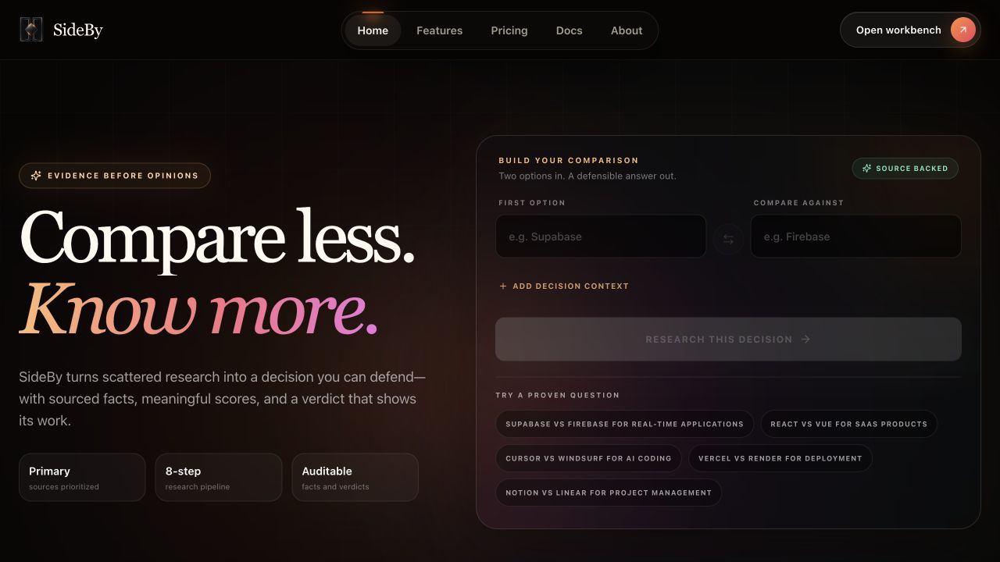
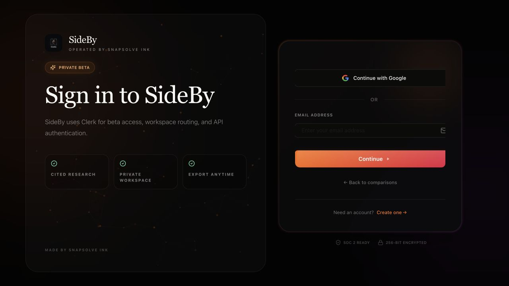
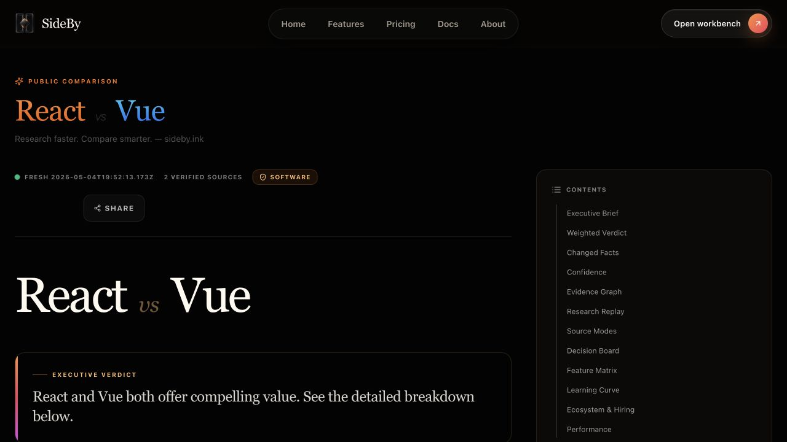

# Product Hunt readiness review

Remediation update, September 7, 2026: all confirmed repository blockers below have been fixed locally. The production build, frontend and API type checks, lint, SEO validation, 138 unit tests, and 30 end-to-end tests now pass. Deployment and the external/account-dependent checks in “Verification still required” remain outside this local verification.

Original audit verdict: not ready to launch yet. Production observations were captured September 4, 2026; the sign-in layout and failing local checks were rechecked September 7. The dirty working tree differs from production.

## Confirmed issues, in priority order

1. **The current checkout cannot produce a clean release.** SEO validation reads the deleted `frontend/public/manifest.json`. Direct Vite build also fails to resolve `workbox-window` from the PWA registration module. Resolve both before deploying; the live site being reachable does not establish that current changes are releasable.
2. **Public research evidence is not launch-quality.** The public React/Vue comparison displays a roughly 70% jobs claim citing the Stack Overflow homepage, and bundle-size claims citing benchmarks.com rather than specific evidence. These claims are present in `frontend/scripts/seed.ts`. The interface presents them as confident research, not illustrative demo data. Replace them with substantiated results and exact citations, or clearly label them illustrative. Its source library, fact counts, and fact-card citations also disagree.
3. **Freshness is misleading.** The public comparison was labelled Fresh with a May 4 timestamp while its source-quality panel reported 0% within 30 days. `ComparisonHeader.tsx` unconditionally renders Fresh. Derive freshness from actual dates and show a readable timestamp.
4. **Auth controls are clipped.** On September 7 at the inspected desktop viewport, the Continue button measured 400px wide, ending at x1140.8; its overflow-hidden wrapper was 378px wide, ending at x1119.8. Clerk's cardBox remains 400px wide. Approximately 21px of the button's right edge is hidden, also affecting other controls. Fix the Clerk cardBox/container sizing before adjusting rounding, then verify both auth routes on desktop and mobile. Production currently has an 8px button radius; the prior local pill styling is not the live result. The previous visual QA pass was incorrect.
5. **Automated checks remain red.** API type checking fails at `api/_lib/__tests__/push.test.ts:152` because `webpush.default` does not exist. Tests: 136 passed, 2 failed out of 138. The failures are a stale notification-copy expectation and an undefined spy target. These are not proof the entire push feature is broken, but must be resolved before a clean release. Frontend type checking and lint passed in the earlier audit.
6. **Social preview metadata is incomplete.** The inspected HTML has no `og:image` or `twitter:image` and uses a summary Twitter card. Add a suitable preview image and verify the actual shared URL preview.

## Remediation completed

- Repaired generated-manifest validation and added the missing direct `workbox-window` dependency; production and E2E builds complete successfully.
- Forced every Clerk form layer to inherit the available width. The Continue button now measures 378px inside a 378px desktop container and 316px inside a 316px mobile container, with a 999px radius and no horizontal page overflow.
- Preserved the requested comparison redirect between sign-in and account creation.
- Replaced beta/implementation copy and unsupported security badges with clear product language and supportable feature statements.
- Marked seeded public comparisons as illustrative in both new seed output and legacy public API detection. The UI now warns that sample data is not live research, uses “reference sources,” and reserves “verified sources” for researched results.
- Replaced the unconditional Fresh label with an honest formatted update date; illustrative records display “Illustrative sample.” Fact counts no longer animate from a misleading zero state.
- Repaired push notification copy, injectable delivery testing, and module typing. All related tests pass.
- Added Open Graph and Twitter image metadata.

## Verification still required

- Complete fresh-user registration, email/Google authentication, and return to the original comparison request. Requiring sign-in is not itself a Product Hunt blocker; Private beta wording alone does not prove registration is restricted.
- Run a real comparison end to end, inspect citations, then exercise follow-up, export, refresh, retry, and free-plan limits. Public seeded results are not a substitute for this test.
- Verify the advertised paid plan's external checkout, entitlement activation, limits, cancellation, and support path. This audit did not purchase a subscription.
- Check mobile auth and the complete first-run journey, basic keyboard accessibility, and launch-traffic behavior. The shallow health endpoint is not a dependency/load test.
- Substantiate the displayed SOC 2 Ready and 256-bit encrypted badges, or replace them with precise, supportable security language. This audit does not establish certification or its absence.
- Confirm Product Hunt listing assets, pricing copy, maker account eligibility, and a usable launch-day access policy. These assets were not verified outside the repository. Official preparation guidance: https://www.producthunt.com/launch/preparing-for-launch . Featuring guidance: https://help.producthunt.com/en/articles/9883485-product-hunt-featuring-guidelines .

## Inspected journey and evidence

1. Loaded the production homepage and selected the React/Vue comparison preset. The preset populated the request.
2. Continued into sign-in. The redirect preserved the comparison request. Observed clipping and technical, beta-oriented copy; did not submit credentials.
3. Opened the public React/Vue comparison independently and inspected claims, sources, counts, and freshness. Public results are accessible without signing in.
4. Checked local build/type/test gates, then rechecked failures September 7. No application code was changed during this audit.

The loading-state capture `02-comparison-ready.png` is not used as evidence of a settled comparison result.
